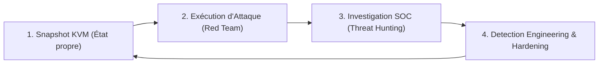

# 🎯 Pourquoi ce CyberLab ? Vision, Guide d'Entraînement & Feuille de Route

Ce document s'adresse à la fois aux **passionnés, étudiants et analystes** cherchant un environnement d'entraînement *Purple Team* léger et reproductible sur une seule machine physique, ainsi qu'aux **équipes techniques et recruteurs** souhaitant comprendre les choix d'architecture, la démarche d'ingénierie et les perspectives d'évolution de ce projet.

---

## 1. Philosophie du Projet : Pourquoi utiliser ce Lab ?

La plupart des environnements d'entraînement en cybersécurité souffrent d'un compromis frustrant :
* Soit ce sont des **machines CTF isolées** (offensif pur), où l'on exploite une faille à l'aveugle sans jamais voir ce qu'un SIEM ou un EDR aurait détecté en face.
* Soit ce sont des **architectures SOC usines à gaz** (nécessitant 32 à 64 Go de RAM et de multiples clics dans des interfaces lourdes), décourageant la pratique quotidienne sur un simple ordinateur portable.

### Ce que propose ce lab :
1. **Zéro friction opérationnelle (100 % CLI sous KVM/Libvirt) :** Conçu pour tourner de manière fluide avec **12 Go de RAM alloués au total** (3 VM de 4 Go) sur un laptop Linux standard. L'orchestrateur maison `cyberlab` démarre l'infrastructure, surveille la consommation mémoire en direct et déploie automatiquement l'espace de travail (consoles SSH en quadrants d'écran + Dashboard SIEM) en une seule commande.
2. **Boucle fermée *Purple Team* en temps réel :** Vous jouez simultanément l'attaquant (*Red Team* sur Kali) et l'analyste SOC / ingénieur détection (*Blue Team* sur Wazuh). Chaque action offensive est immédiatement corrélée, décodée et observable dans le SIEM :
   $$\text{Attaque (Kali)} \longrightarrow \text{Télémétrie Système \& Web (Debian)} \longrightarrow \text{Décodage \& Corrélation (Wazuh)} \longrightarrow \text{Investigation \& Réponse}$$
3. **Problématiques proches du réel :** L'environnement ne fait pas l'impasse sur les contraintes d'entreprise (politiques cryptographiques **FIPS 140-3** sur l'appliance SIEM, gestion des profils systemd/journald, validation stricte des règles XML, audit de conformité **CIS Benchmark**).

---

## 2. Capacités Opérationnelles & Matrice de Détection

Dès son déploiement, le lab couvre un spectre complet de scénarios offensifs et défensifs alignés sur le framework **MITRE ATT&CK** et les exigences de conformité (**PCI DSS**, **NIST 800-53**, **CIS**) :

| Domaine d'Entraînement | Scénario Offensif (Red Team) | Source de Télémétrie (Cible) | Détections & Règles Wazuh (Blue Team) | Cartographie MITRE ATT&CK & Conformité |
| :--- | :--- | :--- | :--- | :--- |
| **Reconnaissance & Force Brute** | Cartographie des services (`nmap`) et attaque par dictionnaire SSH (`hydra`) sur un compte exposé | `journald` / `/var/log/auth.log` | • **5710** : Utilisateur inexistant<br>• **5760 / 5716** : Échec d'authentification SSH<br>• **5720 / 2502** : Force brute caractérisée | **T1110.001** (*Password Guessing*)<br>**T1021.004** (*SSH*)<br>PCI DSS 10.2.4, 10.2.5 |
| **Élévation de Privilèges (Privesc)** | Détournement d'un binaire légitime mal configuré dans `sudoers` (*GTFOBins* via `/usr/bin/find`) | `journald` (`sudo`) | • **5406** : Tentative de commande non autorisée<br>• **5402** : Élévation `sudo` vers `root` réussie | **T1548.003** (*Sudo and Sudo Caching*)<br>PCI DSS 10.2.2, 10.2.5 |
| **Persistance & Altération (FIM)** | Injection de tâches planifiées (`/etc/cron.d/`) et altération de fichiers critiques (`/etc/passwd`) | `syscheck` (`inotify` temps réel + `report_changes="yes"`) | • **554** : Ajout de fichier suspect<br>• **550** : Somme de contrôle modifiée (avec extraction du **diff ligne par ligne**)<br>• **553** : Suppression de fichier | **T1565.001** (*Stored Data Manipulation*)<br>PCI DSS 11.5, NIST SI.7 |
| **Exploitation Applicative Web** | Injections SQL (`UNION SELECT`, `OR 1=1`), *Path Traversal / LFI* (`../etc/passwd`), scans `nikto` | `/var/log/apache2/access.log` & `error.log` | • **31101** : Erreur HTTP 400 suspecte<br>• **31104 / 31106** : Attaque Web réussie (HTTP 200)<br>• **31153** : Attaques Web multiples depuis une même IP<br>• **31168** : Tentative Shellshock | **T1190** (*Exploit Public-Facing App*)<br>PCI DSS 6.5, 11.4 |
| **Audit de Durcissement (Hardening)** | Évaluation de la surface d'exposition système de la cible Debian 13 | Module `sca` (*Security Configuration Assessment*) | • **19004 / 19008 / 19014** : Rapport d'audit automatisé sur plus de 180 points de contrôle système | **CIS Debian Linux 13 Benchmark** |

---

## 3. Guide d'Utilisation pour un Entraînement Optimal

Pour tirer le meilleur parti pédagogique de cette infrastructure, voici le workflow d'entraînement en **4 étapes progressives** recommandé aux utilisateurs du lab :



### Étape 1 : Travailler par Snapshots KVM (Reproductibilité)
Avant de lancer une session d'attaque ou de modifier des configurations système, utilisez la puissance de KVM/Libvirt pour figer l'état sain de la machine cible :
```bash
virsh -c qemu:///system snapshot-create-as DEBIAN_VM_TARGET clean-state "Baseline avant exercice"
```
Cela permet d'expérimenter librement (destructions de fichiers, blocages pare-feu, durcissement SSH) et de revenir à l'état initial en moins de 5 secondes (`virsh snapshot-revert`).

### Étape 2 : Pratiquer le *Threat Hunting* « à l'aveugle »
Lorsque vous passez sur le Dashboard Wazuh après avoir exécuté un scénario d'attaque, **ne filtrez pas directement sur le nom du fichier ou la commande que vous venez de taper** — placez-vous dans les conditions réelles d'un analyste SOC :
1. **Qualification des signaux faibles et forts :** Partez d'une alerte de sévérité élevée (`rule.level >= 7`, comme une règle `31106` ou `550`) ou d'une recherche générique par groupe (`rule.groups: "syscheck"` ou `rule.mitre.tactic: "Privilege Escalation"`).
2. **Reconstruction de la *Kill Chain* (*Timeline Analysis*) :** Une fois un événement suspect isolé sur l'agent `Debian-Cible`, ouvrez une fenêtre temporelle de $\pm 5$ minutes autour de l'incident pour reconstituer toute la séquence de l'attaquant (IP source initiale $\rightarrow$ compte compromis $\rightarrow$ pivot `sudo` $\rightarrow$ persistance).

### Étape 3 : S'initier au *Detection Engineering* (Création de règles)
Les règles par défaut d'un SIEM ne suffisent jamais en production. Ce lab est idéal pour apprendre à réduire les faux négatifs :
* **Cas pratique :** Par défaut, l'évasion GTFOBins `sudo /usr/bin/find . -exec /bin/sh \; -quit` déclenche la règle générique **5402** (*Successful sudo to ROOT executed*), dont la sévérité n'est que de **niveau 3** (considérée comme une action d'administration courante).
* **Exercice :** Utilisez l'outil `/var/ossec/bin/wazuh-logtest` sur le serveur Wazuh pour analyser le log brut, puis rédigez une règle personnalisée dans `/var/ossec/etc/rules/local_rules.xml` (ex. `id="100010"`, `level="12"`, `<if_sid>5402</if_sid>`) qui détecte spécifiquement la présence de `-exec` et `/bin/sh` dans une commande `find` exécutée via `sudo`.

### Étape 4 : S'entraîner au Durcissement (*System Hardening*)
La cible Debian obtient initialement un score de **43 %** au benchmark **CIS Debian Linux 13** dans le module SCA de Wazuh :
* Consultez la liste des contrôles en échec dans le dashboard Wazuh (configuration `sshd_config`, règles `nftables`, politique PAM, permissions de fichiers critiques).
* Appliquez les remédiations sur `DEBIAN_VM_TARGET`, relancez l'analyse SCA et observez l'augmentation du score de conformité tout en vérifiant que les services métiers (Apache, SSH) restent opérationnels.

---

## 4. Limites Connues & Choix d'Architecture

Dans un souci de transparence technique et de frugalité en ressources matérielles, cette première version du lab comporte des limites assumées qu'il est important d'avoir à l'esprit :

1. **Visibilité des processus hors `sudo` :**
   * La collecte actuelle repose sur `journald`, `/var/log/auth.log`, les logs Apache et `syscheck` (FIM). Si un attaquant obtient un shell en tant que `www-data` ou `devuser` et exécute des commandes d'énumération en mémoire sans passer par `sudo` et sans modifier les répertoires surveillés par FIM, ces appels système (`execve`) ne génèrent pas d'alerte faute de démon **`auditd`** configuré.
2. **Périmètre HIDS (Absence de sonde réseau NDR/IDS) :**
   * Wazuh agit ici comme un HIDS/SIEM basé sur les journaux de l'hôte. Les scans de ports furtifs (`nmap -sS`) ou les flux réseau qui n'aboutissent pas à une écriture dans les logs applicatifs ne sont pas visibles sans sonde d'inspection réseau (type Suricata ou Zeek).
3. **Application Web pédagogique (Mock PHP) :**
   * L'endpoint `vuln.php` est conçu pour générer rapidement des traces d'exploitation réalistes dans Apache (SQLi, LFI) avec une empreinte mémoire minimale, mais n'intègre pas encore de moteur SGBD complet (MariaDB/PostgreSQL) ni de WAF (ModSecurity).
4. **Environnement 100 % Linux :**
   * Pour maintenir une consommation RAM compatible avec un ordinateur portable standard ($\le 12\text{ Go}$), le lab se concentre sur l'écosystème Linux et n'inclut pas de domaine Windows Active Directory.

---

## 5. Feuille de Route & Objectifs d'Évolution (Roadmap)

Ce projet a vocation à évoluer par itérations successives pour couvrir des problématiques d'ingénierie SOC et d'automatisation de plus en plus avancées :

### 🎯 Phase 1 — Télémétrie Noyau & Remédiation Automatisée (Court terme)
- [ ] **Intégration de Linux `auditd` (MITRE T1059) :** Déployer `auditd` sur la cible Debian avec un jeu de règles surveillant les appels système `execve` (en particulier toute commande exécutée par l'utilisateur `www-data`) afin de détecter les *webshells* et *reverse shells* dès leur instanciation.
- [ ] **Validation de bout en bout de l'*Active Response* :** Activer et documenter le déclenchement automatique de `firewall-drop` sur le manager Wazuh face aux attaques par force brute (`5720`) et aux scans web agressifs (`31153`), avec mesure du temps de réaction (MTTD / MTTR).
- [ ] **Enrichissement du ruleset local (`local_rules.xml`) :** Publier un jeu de règles de détection sur mesure couvrant les binaires GTFOBins les plus courants et les mécanismes de persistance Linux (`systemd` timers, `LD_PRELOAD`, clés SSH ajoutées).

### 🎯 Phase 2 — Visibilité Réseau (NDR) & Cible Applicative Réaliste (Moyen terme)
- [ ] **Couplage Wazuh + Suricata (IDS/NDR) :** Déployer une sonde **Suricata** avec les règles *Emerging Threats* et ingérer `/var/log/suricata/eve.json` dans Wazuh afin de corréler les alertes réseau (scans Nmap SYN, signatures d'exploits, trafic C2) avec les alertes système de l'hôte.
- [ ] **Stack Web vulnérable conteneurisée :** Ajouter le déploiement optionnel de cibles conteneurisées (*DVWA*, *OWASP Juice Shop*) pour pratiquer l'analyse forensique de compromissions applicatives complètes avec base de données backend.

### 🎯 Phase 3 — *Infrastructure-as-Code* (IaC) & Orchestration SOAR (Moyen / Long terme)
- [ ] **Provisioning automatisé via Ansible :** Codifier l'intégralité de la configuration interne des machines (installation de l'agent Wazuh, déploiement des vulnérabilités, configuration `auditd`/Suricata) dans des playbooks **Ansible** et ajouter une commande `cyberlab reset` pour reconstruire ou réinitialiser les scénarios à la demande.
- [ ] **Automatisation de la réponse aux incidents (SOAR) :** Interconnecter Wazuh avec **Shuffle SOAR** et **TheHive** pour automatiser l'enrichissement d'IoC et l'ouverture de tickets d'investigation structurés.

### 🎯 Phase 4 — Extension Multi-OS (Long terme)
- [ ] **Module optionnel Windows / Active Directory :** Proposer un profil étendu intégrant un poste/serveur Windows instrumenté avec **Sysmon** et l'agent Wazuh pour couvrir la détection des attaques sur l'identité (Kerberoasting, Pass-the-Hash, exécution PowerShell obfusquée).
