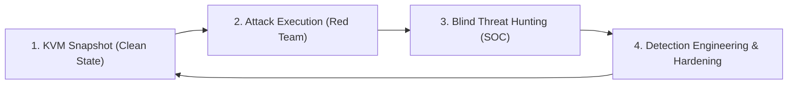

# 🎯 Why This CyberLab? Vision, Training Guide & Engineering Roadmap

This document is written both for **security enthusiasts, students, and analysts** looking for a lightweight, reproducible *Purple Team* homelab that runs on a single laptop, and for **engineering teams and recruiters** interested in the architectural decisions, operational methodology, and technical roadmap behind this project.

---

## 1. Project Philosophy: Why Use This Lab?

Most cybersecurity training environments suffer from a frustrating trade-off:
* Either they are **isolated CTF boxes** (purely offensive), where you exploit vulnerabilities blind without ever seeing what a SIEM or EDR would have detected on the defensive side.
* Or they are **bloated SOC stacks** requiring 32 to 64 GB of RAM and constant clicking across heavy hypervisor GUIs, discouraging daily hands-on practice on a standard laptop.

### What This Lab Delivers:
1. **Zero Operational Friction (100% CLI on KVM/Libvirt):** Engineered to run smoothly within a **12 GB total RAM budget** (three 4 GB VMs) on a standard Linux laptop. The custom `cyberlab` orchestrator boots the infrastructure, monitors live memory telemetry, and automatically deploys the workspace (quadrant-tiled SSH consoles + SIEM Web Dashboard) in a single command.
2. **Closed-Loop *Purple Team* Feedback in Real Time:** You operate simultaneously as the attacker (*Red Team* on Kali) and the SOC analyst / detection engineer (*Blue Team* on Wazuh). Every offensive action is immediately collected, decoded, correlated, and observable in the SIEM:
   $$\text{Attack (Kali)} \longrightarrow \text{System \& Web Telemetry (Debian)} \longrightarrow \text{Decoding \& Correlation (Wazuh)} \longrightarrow \text{Investigation \& Response}$$
3. **Production-Grade Engineering Constraints:** Rather than bypassing enterprise constraints, the lab embraces them: **FIPS 140-3** cryptographic policies on the SIEM appliance, `systemd`/`journald` log pipelines, strict XML schema validation, and automated **CIS Benchmark** compliance auditing.

---

## 2. Operational Capabilities & Detection Matrix

Out of the box, the lab covers a comprehensive range of offensive and defensive scenarios mapped to the **MITRE ATT&CK** framework and industry compliance standards (**PCI DSS**, **NIST 800-53**, **CIS**):

| Training Domain | Offensive Scenario (Red Team) | Telemetry Source (Target) | Wazuh Detections & Rules (Blue Team) | MITRE ATT&CK & Compliance Mapping |
| :--- | :--- | :--- | :--- | :--- |
| **Reconnaissance & Brute Force** | Service enumeration (`nmap`) and SSH dictionary attack (`hydra`) against an exposed user account | `journald` / `/var/log/auth.log` | • **5710**: Non-existent user login attempt<br>• **5760 / 5716**: SSH authentication failure<br>• **5720 / 2502**: Brute-force attack detected | **T1110.001** (*Password Guessing*)<br>**T1021.004** (*SSH*)<br>PCI DSS 10.2.4, 10.2.5 |
| **Privilege Escalation (Privesc)** | Abuse of a misconfigured `sudoers` binary (*GTFOBins* via `/usr/bin/find`) to spawn a `root` shell | `journald` (`sudo`) | • **5406**: Unauthorized `sudo` command attempt<br>• **5402**: Successful `sudo` elevation to `root` | **T1548.003** (*Sudo and Sudo Caching*)<br>PCI DSS 10.2.2, 10.2.5 |
| **Persistence & Tampering (FIM)** | Malicious cron job injection (`/etc/cron.d/`) and critical file tampering (`/etc/passwd`) | `syscheck` (real-time `inotify` + `report_changes="yes"`) | • **554**: Suspicious file added to system<br>• **550**: Integrity checksum changed (with **line-by-line diff extraction**)<br>• **553**: File deleted | **T1565.001** (*Stored Data Manipulation*)<br>PCI DSS 11.5, NIST SI.7 |
| **Web Application Exploitation** | SQL Injection (`UNION SELECT`, `OR 1=1`), *Path Traversal / LFI* (`../etc/passwd`), `nikto` vulnerability scans | `/var/log/apache2/access.log` & `error.log` | • **31101**: Suspicious HTTP 400 error<br>• **31104 / 31106**: Web attack returned HTTP 200 (success)<br>• **31153**: Multiple web attacks from same IP<br>• **31168**: Shellshock attempt detected | **T1190** (*Exploit Public-Facing App*)<br>PCI DSS 6.5, 11.4 |
| **System Hardening Audit** | Automated baseline evaluation of the Debian 13 target's attack surface | Wazuh `sca` module (*Security Configuration Assessment*) | • **19004 / 19008 / 19014**: Automated compliance report across 180+ system controls | **CIS Debian Linux 13 Benchmark** |

---

## 3. How to Use This Lab for Optimal Training

To extract maximum learning value from this environment, follow this **4-step progressive training workflow**:



### Step 1: Leverage KVM Snapshots for Instant Repeatability
Before launching an attack chain or modifying system configurations, use KVM/Libvirt to snapshot the clean state of the target VM:
```bash
virsh -c qemu:///system snapshot-create-as DEBIAN_VM_TARGET clean-state "Clean baseline before exercise"
```
This allows you to experiment freely (file tampering, firewall lockouts, aggressive SSH hardening) and revert to a clean baseline in under 5 seconds (`virsh snapshot-revert`).

### Step 2: Practice "Blind" *Threat Hunting*
When switching to the Wazuh Dashboard after running an attack, **avoid filtering directly on the filename or command you just typed**—approach the investigation as a real SOC analyst would:
1. **Triage High- & Low-Signal Alerts:** Start from high-severity alerts (`rule.level >= 7`, such as rule `31106` or `550`) or broad behavioral queries (`rule.groups: "syscheck"` or `rule.mitre.tactic: "Privilege Escalation"`).
2. **Reconstruct the *Kill Chain* (*Timeline Analysis*):** Once a suspicious event is isolated on `Debian-Target`, pivot to a $\pm 5$-minute time window around the incident to reconstruct the attacker's full sequence (initial source IP $\rightarrow$ compromised account $\rightarrow$ failed `sudo` attempts $\rightarrow$ `root` escalation $\rightarrow$ persistence mechanism).

### Step 3: Practice *Detection Engineering* (Custom Rules)
Out-of-the-box SIEM rules are never sufficient in production. This lab provides a safe sandbox to practice reducing false negatives:
* **Case Study:** By default, the GTFOBins escape `sudo /usr/bin/find . -exec /bin/sh \; -quit` only triggers generic **Rule 5402** (*Successful sudo to ROOT executed*), which carries a low **severity level of 3** (treated as routine administrative activity).
* **Exercise:** Run `/var/ossec/bin/wazuh-logtest` on the Wazuh server to inspect how the raw log is decoded, then author a custom child rule in `/var/ossec/etc/rules/local_rules.xml` (e.g., `id="100010"`, `level="12"`, `<if_sid>5402</if_sid>`) that specifically flags `-exec` and shell binaries (`/bin/sh`, `/bin/bash`) passed to `find` under `sudo`.

### Step 4: Practice *System Hardening*
Out of the box, the Debian target scores **43%** against the **CIS Debian Linux 13 Benchmark** in Wazuh's SCA module:
* Review failed controls in the Wazuh Dashboard (`sshd_config` hardening, `nftables` default policy, PAM password complexity, sensitive file permissions).
* Apply remediations on `DEBIAN_VM_TARGET`, re-run the SCA check, and track your compliance score improvements while ensuring legitimate services (Apache, SSH) remain functional.

---

## 4. Known Limitations & Architectural Trade-Offs

To keep the lab lightweight and transparent, this initial iteration makes several deliberate architectural trade-offs:

1. **Unprivileged Process Visibility (No `auditd` / eBPF Yet):**
   * Current telemetry relies on `journald`, `/var/log/auth.log`, Apache logs, and `syscheck` (FIM). If an attacker obtains a shell as `www-data` or `devuser` and runs in-memory reconnaissance commands without invoking `sudo` and without modifying FIM-monitored directories, those `execve` system calls do not generate alerts until **`auditd`** is deployed.
2. **Host-Centric Visibility (HIDS Only, No Network NDR/IDS Sensor):**
   * Wazuh operates here as a log-based HIDS/SIEM. Stealth port scans (`nmap -sS`) or network flows that do not produce application-layer log entries remain invisible without a network packet inspection sensor (such as Suricata or Zeek).
3. **Lightweight Mock Web Endpoint (`vuln.php`):**
   * The `vuln.php` script is designed to generate realistic Apache access/error log traces (SQLi, LFI) with near-zero memory overhead, rather than running a full relational database backend (MariaDB/PostgreSQL) or WAF (ModSecurity).
4. **Linux-Only Footprint:**
   * To stay within a $\le 12\text{ GB}$ RAM envelope suitable for a single laptop, the lab focuses on Linux workloads and does not currently include a Windows Active Directory domain.

---

## 5. Engineering Roadmap & Future Evolutions

This lab is actively evolving across four milestones to cover deeper detection engineering, network visibility, and SOC automation use cases:

### 🎯 Milestone 1 — Kernel Telemetry & Automated Remediation (Short Term)
- [ ] **Linux `auditd` Integration (MITRE T1059):** Deploy `auditd` on the Debian target with rules monitoring `execve` system calls (specifically tracking commands spawned by `www-data`) to detect webshells and reverse shells at execution time.
- [ ] **End-to-End *Active Response* Validation:** Enable and benchmark automated `firewall-drop` remediation on the Wazuh Manager against SSH brute force (`5720`) and aggressive web scanning (`31153`), measuring Mean Time to Detect (MTTD) and Mean Time to Respond (MTTR).
- [ ] **Custom Detection Ruleset (`local_rules.xml`):** Publish a curated set of custom rules elevating alert severity for common GTFOBins abuses and Linux persistence techniques (`systemd` timers, `LD_PRELOAD`, unauthorized SSH key additions).

### 🎯 Milestone 2 — Network Visibility (NDR) & Realistic Web Stack (Medium Term)
- [ ] **Wazuh + Suricata (IDS/NDR) Integration:** Deploy a **Suricata** sensor with *Emerging Threats* rules and ingest `/var/log/suricata/eve.json` into Wazuh to correlate network-level events (SYN scans, exploit signatures, outbound C2 traffic) with host-level telemetry.
- [ ] **Containerized Vulnerable Web Applications:** Add optional Docker-based targets (*DVWA*, *OWASP Juice Shop*) backed by a real SQL database to practice full-chain web forensics (SQLi $\rightarrow$ Webshell upload $\rightarrow$ `www-data` RCE $\rightarrow$ `root` privilege escalation).

### 🎯 Milestone 3 — *Infrastructure-as-Code* (IaC) & SOAR Integration (Medium / Long Term)
- [ ] **Automated Provisioning with Ansible:** Codify all guest configurations (Wazuh agent enrollment, vulnerable services, `auditd`/Suricata rules) into **Ansible** playbooks and add a `cyberlab reset` command to rebuild or reset scenarios on demand.
- [ ] **SOAR Incident Response Automation:** Connect Wazuh to **Shuffle SOAR** and **TheHive** to automate IoC enrichment and structured incident case creation.

### 🎯 Milestone 4 — Cross-Platform / Active Directory Expansion (Long Term)
- [ ] **Optional Windows / Active Directory Node:** Provide an extended hardware profile featuring a Windows Server / Workstation instrumented with **Sysmon** and the Wazuh Agent to practice detecting identity-based attacks (Kerberoasting, Pass-the-Hash, obfuscated PowerShell execution).
